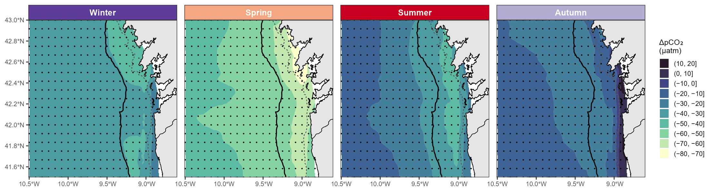

<div align="center">

# *f*CO₂GalicIA

**A machine-learning ensemble for sea–air ΔfCO₂ in the NW Iberian Upwelling System**

[](LICENSE)
[](pyproject.toml)
[](examples/example_basic.R)
[](#citation)
[](https://digital.csic.es/handle/10261/447565)
<!-- After the first GitHub release is archived in Zenodo, add:
[](https://doi.org/10.5281/zenodo.XXXXXXX)
-->

[Quick start](#quick-start) ·
[How it works](#how-it-works) ·
[Performance](#performance) ·
[Input data](#input) ·
[Citation](#citation)

</div>

<p align="center">
  
</p>

<p align="center"><sub>
<b>Seasonal climatology of detrended surface ΔpCO₂ (µatm) from <i>f</i>CO₂GalicIA, 1998–2021.</b>
Dots are the nodes of the 0.083° grid. Black and dashed grey lines are the 200 m and 70 m isobaths.
Top row of Figure 5 in Fontela &amp; Padín (under review).
</sub></p>

*f*CO₂GalicIA estimates the sea–air difference in CO₂ fugacity at the ocean surface of the
NW Iberian Upwelling System (41.5–43.0°N, 10.5–8.0°W). You give it location, date, sea surface
temperature, salinity, chlorophyll-a and the coastal Upwelling Index; it returns ΔfCO₂ in µatm.
It is the ensemble described in Fontela & Padín (under review) and the model behind the
[weekly gridded product (1998–2021)](https://digital.csic.es/handle/10261/447565).

> [!NOTE]
> **Sign convention.** ΔfCO₂ = *f*CO₂,sw − *f*CO₂,atm. Positive values mean the ocean is a CO₂
> **source** to the atmosphere; negative values mean the ocean is a CO₂ **sink**.

## At a glance

| | |
|---|---|
| **Domain** | NW Iberian Upwelling System, 41.5–43.0°N, 10.5–8.0°W (rías, shelf and ocean) |
| **Output** | ΔfCO₂ (µatm) for each input row |
| **Training data** | surface *f*CO₂ observations ([*f*CO₂IIM](http://hdl.handle.net/10261/447530) 1997–2014 + SOCAT v2023) |
| **Valid years** | 1994–2021 (see `manifest.json`); the gridded product covers 1998–2021 |
| **Ensemble** | Unweighted mean of Random Forest, Support Vector Regresion and XGBoost |
| **Skill (independent test set)** | RMSE 13.3 µatm · MAE 7.3 µatm · R² 0.89 |
| **Total uncertainty** | 16.9 ± 1.5 µatm (about 53 % lower than global coastal products in this region) |
| **Dependencies** | NumPy and pandas (matplotlib optional). No scikit-learn or XGBoost needed |

## Quick start

```bash
pip install git+https://github.com/mfontela/fCO2GalicIA.git
```

or clone the repository and run the example:

```bash
git clone https://github.com/mfontela/fCO2GalicIA.git
cd fCO2GalicIA
pip install -r requirements.txt
python examples/example_basic.py
```

```python
import pandas as pd
import fco2galicia as fg

model = fg.load_model()                            # verifies SHA-256 checksums
obs = pd.read_csv("examples/input_example.csv")    # predictors + date
out = model.predict(obs)                           # adds column deltafCO2 (µatm)
```

From R, through [reticulate](https://rstudio.github.io/reticulate/):

```r
source("examples/example_basic.R")
```

## How it works

The target variable is the sea–air fugacity difference:

$$
\Delta f\mathrm{CO_2} = f\mathrm{CO_{2,sw}} - f\mathrm{CO_{2,atm}}
$$

Each of the three models was trained on the same predictors:

$$
\Delta f\mathrm{CO_2} \sim \mathrm{SST} + \mathrm{SSS} + \mathrm{CHL} + \mathrm{CHL_7} + \mathrm{UI} + \mathrm{UI_7} + \mathrm{lat} + \mathrm{lon} + \mathrm{year} + \mathrm{week}
$$

The ensemble prediction is the unweighted mean of the three:

$$
\widehat{\Delta f\mathrm{CO_2}} = \frac{1}{3}\left(\hat{y}_\mathrm{RF} + \hat{y}_\mathrm{SVR} + \hat{y}_\mathrm{XGB}\right)
$$

The models were trained with observation weights based on each measurement's quality class.
They were validated with 10-fold cross-validation and evaluated on an independent 25 % test set.

## Performance

Scores on the independent test set (25 % of observations, never used in training):

| Model | RMSE (µatm) | MAE (µatm) | R² |
|---|---:|---:|---:|
| **Ensemble (*f*CO₂GalicIA)** | **13.3** | **7.3** | **0.89** |


**Uncertainty budget.** The total uncertainty combines four independent terms in quadrature:

$$
u_\mathrm{total} = \sqrt{u_\mathrm{obs}^2 + u_\mathrm{atm}^2 + u_\mathrm{model}^2 + u_\mathrm{predictors}^2}
$$

| Term | Value (µatm) | Origin |
|---|---:|---|
| $u_\mathrm{obs}$ | 7.7 | Weighted measurement uncertainty from the quality flags |
| $u_\mathrm{atm}$ | 1.0 | Atmospheric reference (interpolation, pressure, water vapour) |
| $u_\mathrm{model}$ | 13.3 | Ensemble RMSE on the test set |
| $u_\mathrm{predictors}$ | 6.9 ± 3.1 | Monte Carlo propagation of SST, SSS, CHL and UI errors |
| **Total** | **16.9 ± 1.5** | Range 15.6–20.1 across the domain |


## Input

| Column | Units | Variable | Source used in training |
|---|---|---|---|
| `thetao` | °C | Sea surface temperature | CMEMS IBI_MULTIYEAR_PHY_005_002 |
| `so` | – | Sea surface salinity | CMEMS IBI_MULTIYEAR_PHY_005_002 |
| `CHL` | mg m⁻³ | Surface chlorophyll-a | CMEMS OCEANCOLOUR_ATL_BGC_L4_MY_009_118 |
| `CHL_7` | mg m⁻³ | 7-day trailing median of `CHL` | same as `CHL` |
| `UI` | m³ s⁻¹ km⁻¹ | Upwelling Index at 42°N 10°W | [IEO-CSIC](http://www.indicedeafloramiento.ieo.es) |
| `UI_7` | m³ s⁻¹ km⁻¹ | 7-day trailing median of `UI` | same as `UI` |
| `lat`, `lon` | °N, °E | Position (longitude negative west) | – |
| `date` | YYYY-MM-DD | Year and ISO week are derived from it | – |

> [!WARNING]
> **Extrapolation.** Inputs outside the valid ranges in
> [`model/fCO2GalicIA/manifest.json`](model/fCO2GalicIA/manifest.json) still return a number,
> but the package warns that the value is extrapolated. This includes positions outside
> the domain and years after 2021. Treat such values with caution and check them against
> independent observations. Rows with any missing input return NaN.


## Related resources

| Resource | Link |
|---|---|
| Weekly gridded ΔfCO₂, uncertainty and air–sea CO₂ flux, 1998–2021 (Fontela & Padín, 2026) | [DIGITAL.CSIC 10261/447565](https://digital.csic.es/handle/10261/447565) |
| *f*CO₂IIM surface underway observations, 1997–2014 (Padín et al., 2026) | [DIGITAL.CSIC 10261/447530](https://digital.csic.es/handle/10261/447530) |
| SOCAT, Surface Ocean CO₂ Atlas (Bakker et al., 2016) | [socat.info](https://socat.info) |

## Citation

If you use *f*CO₂GalicIA, please cite the article. You can also use the
**"Cite this repository"** button on GitHub, which reads [`CITATION.cff`](CITATION.cff).


## Frequently asked questions

<details>
<summary><b>Can I use the model outside the 41.5–43.0°N, 10.5–8.0°W domain?</b></summary>

The model will return a number, but it is an extrapolation and the package warns about it.
The same applies to any input outside the ranges in `manifest.json`, including years after 2021.
Check such values against independent observations whenever possible.
</details>

<details>
<summary><b>Why are 7-day medians needed for chlorophyll and UI?</b></summary>

Biological carbon uptake and the carbonate system's response to upwelling pulses act over
days to a week. Removing the 7-day predictors and the instantaneous ones together raised
the test RMSE by 16 %. Keeping only one timescale raised it by 5–6 %.
</details>

<details>
<summary><b>Can I use daily satellite images instead of weekly composites?</b></summary>

Yes. The model does not depend on the temporal resolution of the inputs, as long as the
units match the table above. `CHL_7` and `UI_7` must still be 7-day trailing medians of
`CHL` and `UI`.
</details>

<details>
<summary><b>How is the ensemble prediction computed?</b></summary>

`deltafCO2` is the unweighted arithmetic mean of the Random Forest, SVR and XGBoost
predictions. A row with any missing input returns NaN.
</details>

<details>
<summary><b>Do I need scikit-learn, XGBoost or R to run it?</b></summary>

No. The three models are stored as plain NumPy arrays (`.npz`) and evaluated with NumPy.
The loader checks every file's SHA-256 checksum, and `model.self_test()` reproduces the
reference predictions stored in `manifest.json`.
</details>

<details>
<summary><b>Repository structure</b></summary>

```text
fCO2GalicIA/
├── README.md                     this file
├── LICENSE                       MIT licence
├── CITATION.cff                  citation metadata
├── pyproject.toml                package definition (pip install .)
├── requirements.txt              dependencies (numpy, pandas; matplotlib optional)
├── fco2galicia/                  prediction package (NumPy + pandas)
│   ├── __init__.py               public API: load_model, add_time_predictors
│   └── core.py                   ensemble evaluators, input checks, R bridge
├── model/
│   └── fCO2GalicIA/
│       ├── manifest.json         predictors, units, valid ranges, checksums, reference predictions
│       ├── random_forest.npz     Random Forest
│       ├── svr.npz               Support Vector Regression (RBF kernel)
│       └── xgboost.npz           XGBoost
├── examples/
│   ├── example_basic.py          demonstration script (Python)
│   ├── example_basic.R           demonstration script (R, through reticulate)
│   ├── input_example.csv         example input data
│   ├── output_example.csv        example output (generated)
│   └── output_example.png        example figure (generated)
├── docs/img/                     figures used in this README
└── tests/
    └── test_fco2galicia.py       pytest suite
```

</details>

## Acknowledgements

MF was funded by PTA2022-021307-I, MCIN/AEI/10.13039/501100011033 and by FSE+.
The CAPTA project (0062_CAPTA_1_E) is co-financed by the European Union through the Interreg
Spain–Portugal Cross-Border Cooperation Programme (POCTEP) 2021–2027. The REDEIRA project
(TED2021-132188B-I00) also supported this work.

## License and contact

Released under the [MIT License](LICENSE).

**Marcos Fontela** · [mfontela@iim.csic.es](mailto:mfontela@iim.csic.es) ·
[ORCID 0000-0002-7486-0922](https://orcid.org/0000-0002-7486-0922)<br/>

Instituto de Investigacións Mariñas (IIM-CSIC), Vigo, Spain.
